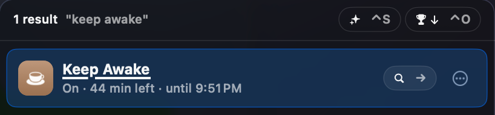
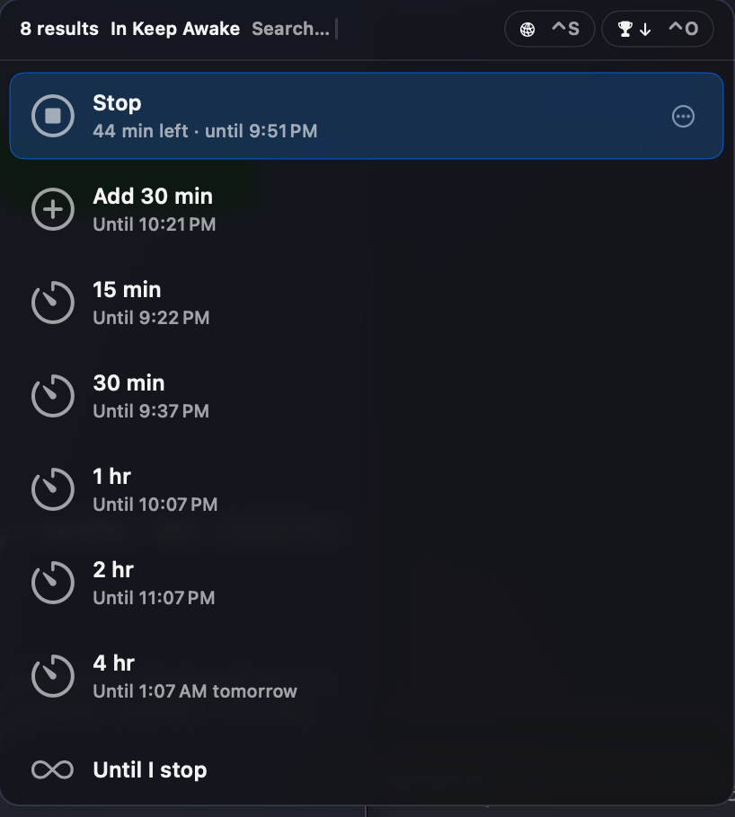

# Keep Awake for Tuna

A [Tuna](https://tunaformac.com) extension that keeps your Mac awake for a while, like
`caffeinate`, and shows how much time is left.

Type `awake` in Tuna. The "Keep Awake" entry shows the status: `Off`, or
`On · 37 min left · until 3:40 PM`. Press → to step into it and pick a length (15 min to
4 hr, or Until I stop), or type one: `45`, `45m`, `1h30m`, `until 6pm`, `18:00`. While a
session runs, the first rows are Stop and Add 30 min. Picking a new length replaces the
running session.

Settings → Sources → Keep Awake → Screen chooses whether the screen stays on too
(default) or may turn off while the Mac keeps running.

## How it works

Each session is one `/usr/bin/caffeinate` process (`-d -i`, or `-i` when the screen may
turn off, plus `-t` for timed sessions), so it ends by itself on time. The session is
saved to `~/Library/Application Support/com.yuchenli.tuna.keepawake/session.json`, so
the status survives a Tuna restart. caffeinate keeps running if Tuna quits.

As with any `caffeinate` session, closing the lid on a laptop without an external display
still puts the Mac to sleep.

## Requirements

- Tuna 0.96 or later on an Apple silicon Mac.

## Install

See [Install](../README.md#install). From source: `./scripts/install.sh KeepAwake --restart`.
