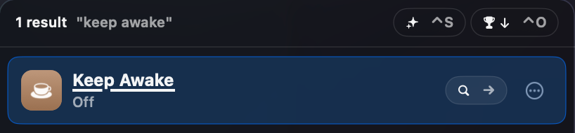
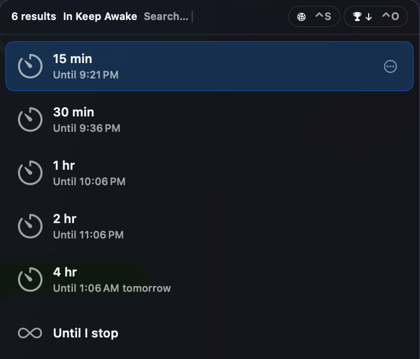
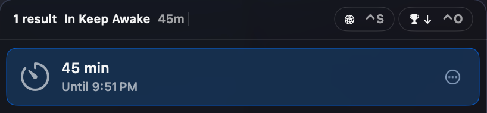
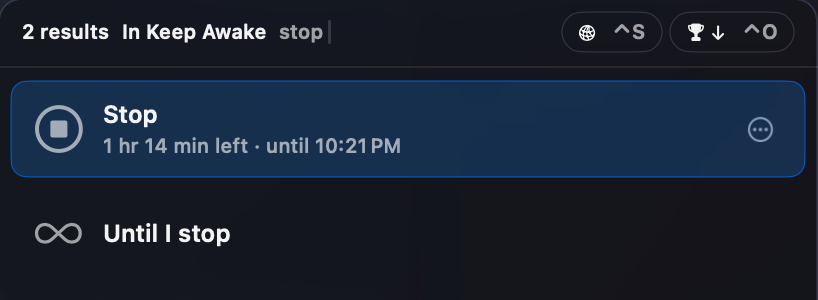

# 变更记录

## 2026-10-27

### 两个插件放进同一个仓库

- Cardinal 和 Keep Awake 现在放在同一个仓库里，各占一个文件夹，各有自己的说明页。仓库首页用一张表列出每个插件做什么。
- 对用户：
  - 从 Releases 下载时，每个插件单独一个压缩包，比如 "KeepAwakeTuna-0.1.0.zip"、"CardinalTuna-0.1.0.zip"，按需装。
  - 从源码装时，可以一次装全部，也可以只装一个。
  - 已经装好的插件不用重装，名字没变。
- 版本号各自独立：每个插件发布时单独打版本标签，比如 "keepawake-v0.1.0"。

### Keep Awake 第一版：在 Tuna 里让 Mac 保持唤醒，并能看到剩余时间

- **入口**：在 Tuna 里输入 "awake"（也能搜 "caffeinate"、"stay awake"、"prevent sleep"），找到 "Keep Awake"。
- **状态就写在入口下面那行**，每次打开 Tuna 都是最新的：
  - 没开："Off"
  - 开了有时限："On · 44 min left · until 9:51 PM"，同时写剩余时间和结束时刻，不用自己算。
  - 开了没时限："On · until you stop"

  
  

- **选时长**：选中 "Keep Awake" 后按 → 进入，列出 "15 min"、"30 min"、"1 hr"、"2 hr"、"4 hr"、"Until I stop"。每一行下面写选了以后到几点结束，比如 "Until 9:22 PM"。过了午夜写 "tomorrow"。回车立即生效，Tuna 窗口关闭。

  

- **开着的时候再进去**，最上面多两行：
  - "Stop"：下面写还剩多少、到几点。没时限的写 "On since 2:10 PM"。
  - "Add 30 min"：在现在的结束时间上再加 30 分钟，下面写加完到几点。没时限时不出现。
  - 再选一个时长，就从现在起重新算，替换原来的设置。
  - 已经是 "Until I stop" 时，这一行不再出现。

  

- **直接打字输入时长**：进入后可以直接打 "45"、"45m"、"1h30m"、"1.5 hours"，或者打时刻 "until 6pm"、"6:30 pm"、"18:00"。
  - 只打数字按分钟算，所以 "45" 是 45 分钟。
  - "until 6" 这种没写上午下午的，取最近的那个 6 点。
  - 打的内容排第一行，下面跟着名字能对上的其他行，比如打 "stop" 会出现 "Stop" 和 "Until I stop"。
  - 看不懂时提示 "Can’t read “…”"，并给出写法示例 "Try 45m, 1h30m or until 6pm"。
  - 一次最多 24 小时。超过时提示 "Up to 24 hr"，更长请选 "Until I stop"。

  
  

- **屏幕要不要一起保持亮着**：在 Tuna 的 Settings → Sources → Keep Awake 里设置 "Screen"：
  - "Keep screen on"（默认）：屏幕和电脑都不睡，适合看东西、演示。
  - "Let screen turn off"：屏幕可以按平时设置熄灭或锁屏，电脑继续运行，适合下载、跑任务。
  - 改了设置只对下一次开启生效。"Add 30 min" 沿用当前这次的设置。
- **业务规则**
  - 时间到了自动结束，Mac 恢复平时的睡眠设置。到点不提醒，Tuna 插件没有通知功能。
  - 退出或重启 Tuna 不影响正在进行的计时，重新打开 Tuna 状态还在。重启电脑后计时清零。
  - 和 macOS 自带的防休眠一样，笔记本合上盖子（没接外接显示器）照样会睡。
  - 入口图标固定是棕色咖啡杯，开没开看下面那行字。

## 2026-10-22

### Cardinal 第一版：在 Tuna 里用 Cardinal 搜全盘文件

- **入口**：在 Tuna 里输入 "file"（或 "find"、"cardinal"），选中 "Search Files" 这一项后按 → 进入。进入后，接下来输入的内容都交给 Cardinal 搜索。
  - 入口叫 "Search Files" 而不是 "Cardinal"：用户想的是"找文件"这件事，不会去想背后用的是哪个应用。
  - Tuna 会记住你的选择，用过几次以后，输入 "f" 就能选中它。
  - Tuna 的插件接口不支持把搜索结果直接混进主搜索框，所以必须先进入这个入口再搜。
- **名字记得不完全准也能找到**：Cardinal 只做连续字符匹配，搜 `change.md` 找不到 `changes.md`。现在搜不到时，会自动把关键词按标点拆成几个词再搜一次（`change.md` 拆成 `change` 和 `md`，要求名字里两个词都有）。用了 Cardinal 语法的搜索不会拆。
- **边打字边出结果**：停止输入约 0.12 秒后就会发起搜索。Cardinal 一般在 0.1 秒内返回，只输入一个字母时约 0.3 秒。
- **每条结果**
  - 文件名，下面一行是所在文件夹和修改时间，例如 "~/Documents · 2 days ago"。
  - 显示 Tuna 自带的文件图标和预览。
  - 回车直接打开文件。按 Tab 进入动作栏，可以用 Tuna 对文件的所有操作（在访达中显示、Quick Look、移动等）。
  - ".app" 这类应用程序包当作一个整体，不会被当成可以点进去浏览的文件夹。
- **排序**：直接沿用 Cardinal 给的顺序，即个人文件优先，系统、应用内部、缓存、编译生成的文件排在最后。
- **条数**：最多显示 50 条。Cardinal 找到更多时，最后一条是 "Show all 12,345 results in Cardinal"，选中后会打开 Cardinal 窗口，并填好同样的关键词。全部结果都已显示时，不出现这一条。
- **各种状态的提示**
  - 刚进入、还没输入时："Search every file on this Mac"，并提示可以用 Cardinal 的搜索语法。
  - Cardinal 没在运行：只显示一条 "Open Cardinal"，选中后会在后台启动 Cardinal，Tuna 窗口保持打开，可以接着搜。
  - Cardinal 第一次扫描全盘还没完成："Cardinal is indexing this Mac"，并显示已扫描的文件数。
  - 没搜到："No files found"。
  - 搜索语法写错："Check the search syntax"，并显示 Cardinal 给出的具体错误。
  - Cardinal 正忙："Cardinal is busy"。
- **不需要任何设置**：插件会自动读取 Cardinal 每次启动时生成的访问钥匙。
- **需要的 Cardinal 版本**：必须是我们 fork 里带查询接口的版本，官方版本没有这个接口。
